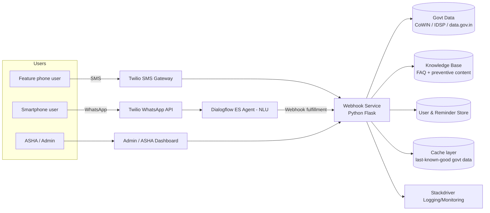
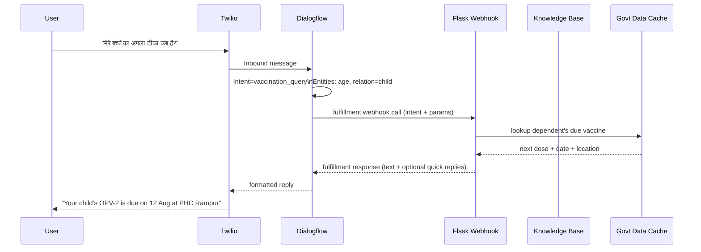
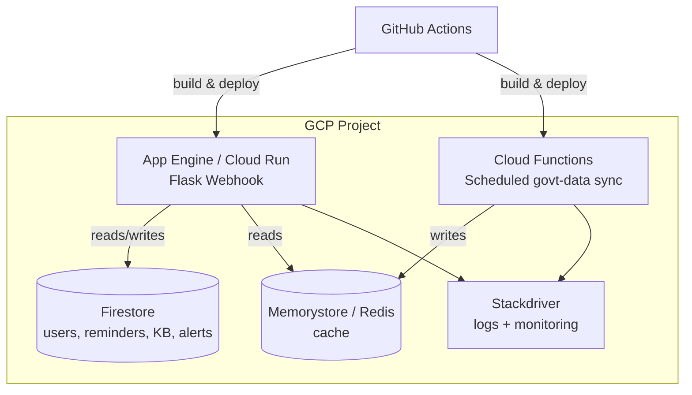

# Architecture — SUSHRUTA (The HealthBot)

## 1. System Context



## 2. Components

| Component | Responsibility | Tech |
|---|---|---|
| WhatsApp channel | Rich chat UI (buttons, quick replies) for smartphone users | Twilio WhatsApp Business API |
| SMS channel | Numeric-menu fallback for feature phones | Twilio SMS Gateway |
| NLU layer | Intent classification, entity extraction, context/session management | Google Cloud Dialogflow ES |
| Webhook service | Fulfillment logic: routes intent → handler, talks to KB/DB/gov data, formats response | Python Flask, deployed on GCP App Engine / Cloud Functions |
| Knowledge base | Versioned, multilingual FAQ & preventive-care content | JSON/Firestore documents, admin-editable |
| Govt data adapter | Fetches/caches vaccination schedules (CoWIN) and outbreak signals (IDSP) | Scheduled Cloud Function + cache (Memorystore/Redis) |
| User & reminder store | Phone-hash keyed profiles, dependents, reminder schedule, consent flag | Firestore / Cloud SQL |
| Admin/ASHA dashboard | View query trends, manage KB, publish alerts | Web app (React or static HTML) calling backend REST APIs |
| CI/CD | Build, test, deploy | GitHub Actions, Docker |
| Observability | Logs, error tracking, uptime | GCP Stackdriver |

## 3. Conversation Flow (Sequence)



## 4. Intent → Handler Map

| Intent | Handler | Data sources touched |
|---|---|---|
| `symptom_check` | Match symptom keywords → guidance text; red-flag keywords → escalate | Knowledge base |
| `vaccination_query` | Look up dependent profile, compute next due dose | User store, national immunization schedule (cached CoWIN) |
| `outbreak_alert_query` | Look up latest alert for user's district/pincode | Govt data cache (IDSP) |
| `faq` | Retrieve best-matching KB entry in user's language | Knowledge base |
| `misinformation_check` | Match submitted text against KB / known-rumor list | Knowledge base |
| `human_handoff` | Return nearest facility/helpline contact | Static facility directory |
| low-confidence (any) | Fallback to `human_handoff` | — |

## 5. Data Model (simplified)

```
User
  id (hash of phone number)
  preferred_language
  district / pincode
  consent_given: bool
  consent_timestamp
  dependents: [Dependent]

Dependent
  name
  dob
  relation (self/child/elder)
  vaccination_history: [{vaccine, date_given}]

Reminder
  user_id
  dependent_name
  vaccine
  due_date
  sent: bool

OutbreakAlert
  id
  district / pincode
  disease
  severity
  message
  published_at
  published_by (admin id)

KnowledgeBaseEntry
  id
  topic
  language
  question_variants: [string]
  answer
  source
  updated_at
  updated_by
```

## 6. API Contract (Webhook Service)

Base path: `/api/v1`

| Method | Path | Purpose |
|---|---|---|
| POST | `/webhook/dialogflow` | Dialogflow fulfillment endpoint (intent in, fulfillment text out) |
| POST | `/webhook/sms` | Twilio SMS inbound webhook (numeric-menu state machine) |
| POST | `/chat` | Demo-only: direct chat endpoint used by the prototype frontend (bypasses Twilio/Dialogflow, same handler logic) |
| GET | `/kb` | List knowledge-base entries |
| POST | `/kb` | Create/update a knowledge-base entry (admin) |
| DELETE | `/kb/{id}` | Retire a knowledge-base entry (admin) |
| GET | `/alerts` | List outbreak alerts |
| POST | `/alerts` | Publish a new outbreak alert (admin) |
| GET | `/stats` | Aggregated, anonymized query stats for dashboard |
| GET | `/users/{id}/reminders` | Upcoming reminders for a user (demo/testing) |

For the hackathon prototype, `/chat` reproduces the exact intent-routing logic that
Dialogflow would call via `/webhook/dialogflow`, so the same backend demonstrates both the
production integration path and a directly-testable demo without external credentials.

## 7. Deployment View



## 8. Key Design Decisions

- **Webhook stays stateless**: All session/context state lives in Dialogflow's own session
  management; the Flask service only holds durable data (users, reminders, KB, alerts),
  making it trivially horizontally scalable.
- **Cache-first for govt data**: CoWIN/IDSP calls are never on the hot path of a user
  message; a scheduled sync job refreshes a cache, and the webhook always reads from cache
  with a visible "as of" timestamp — protects latency and availability from upstream
  government API flakiness.
- **Escalate rather than guess**: Any low-confidence NLU result or symptom red flag routes to
  a human/facility handoff instead of the bot attempting an answer — a safety-first choice
  appropriate for a health domain.
- **One handler, two entry points**: `/webhook/dialogflow` (production) and `/chat` (demo)
  call the same intent-handler functions, so the hackathon prototype is not throwaway code —
  it is the real fulfillment logic minus the Dialogflow/Twilio wrapper.
- **Privacy by minimization**: phone numbers are hashed before storage, raw conversation text
  is not retained beyond a short window, and consent is captured on first contact.

## 9. Prototype Scope vs. Production Scope

| Layer | Hackathon prototype (this repo) | Production |
|---|---|---|
| NLU | Lightweight rule/keyword-based intent matcher (`backend/nlu.py`) standing in for Dialogflow | Google Cloud Dialogflow ES agent |
| Channels | Web-based chat simulator + numeric SMS-menu simulator | Twilio WhatsApp Business API + Twilio SMS |
| Govt data | Mocked CoWIN/IDSP JSON fixtures (`backend/data/`) | Live `data.gov.in`, CoWIN, IDSP integrations |
| Storage | In-memory store (reset on restart) | Firestore / Cloud SQL |
| Auth | None (local demo) | Signed webhook verification, admin auth on dashboard |

This mirrors how the team should evolve the prototype into the MVP described in the PRD's
milestones without a rewrite — only the adapters change.
